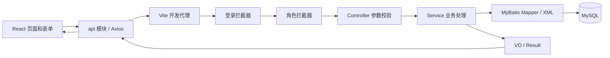
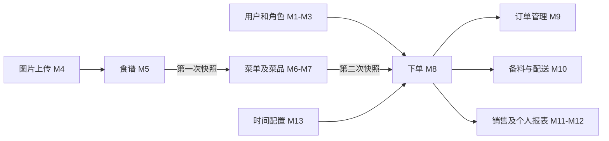

# 企业餐厅网络点餐系统答辩文档

本文沿用 [系统设计文档](docs/design.md) 的 M1—M13 模块编号和四人分工，技术说明以当前项目代码为依据。适合按“模块职责 → 工具 → 实现原理 → 前后端链路 → 演示与追问”的顺序讲解。

原设计保留了开发早期内容，答辩时应注意：前端现已实现；Excel 使用 **Apache POI**，不是 EasyExcel；密码使用 SHA-256 加盐散列，不是 BCrypt；批量导入是成功行入库、失败行返回原因；图片上传、模板下载、四类 Excel 导出及菜单改名均已实现。原设计中的接口总数和 TODO 数量不作为当前实现统计。

## 一、总体架构与分工

### 1. 项目介绍口述

本系统面向企业内部餐厅，覆盖员工订餐、餐厅经理维护用户和菜单、厨房备料、配餐配送及财务统计。系统采用前后端分离架构，通过 Session 识别用户，通过角色注解控制接口权限。业务重点是订餐时间窗口、每人每日一单，以及食谱、菜单、订单之间的快照隔离。

### 2. 实际使用的技术和工具

| 技术或工具 | 在本项目中的用途 |
|---|---|
| Java 21、Spring Boot 4.1.1 | 后端运行环境、依赖注入、Web 接口和应用配置 |
| Spring MVC | 接收 HTTP 请求，绑定 JSON、表单文件和路径参数 |
| MyBatis 4.1.0 | Mapper 接口与 XML SQL 对应，显式实现查询、更新和批量插入 |
| MySQL | 保存用户、食谱、菜单、订单和系统配置；利用唯一索引约束数据 |
| React 19、TypeScript | 组件化页面、状态更新及前端类型约束 |
| Vite 8、React Router 7 | 前端构建、开发代理、页面路由和登录守卫 |
| MUI、MUI X Date Pickers、Day.js | 表格、弹窗、表单、日期和分钟精度时间选择 |
| Axios | 统一请求、携带 Cookie、处理 JSON 业务错误和 Blob 下载 |
| Apache POI 5.4.1 | 读取 xls/xlsx，生成模板和 xlsx 报表 |
| MinIO Java SDK 8.5.13 | 上传和读取图片对象 |
| Jakarta Bean Validation | DTO 非空、长度、数量等参数校验 |
| Lombok、SLF4J | 减少实体样板代码，记录业务日志 |
| Maven Wrapper、npm | 后端依赖与测试、前端依赖与构建 |
| JUnit、Spring Boot Test、MockMvc | 验证恢复脚本、业务逻辑和图片访问等行为 |

版本来自项目 `pom.xml` 和 `frontend/package.json`；前端带 `^` 的声明表示允许兼容版本范围。

### 3. 公共请求链路



开发环境请求通常由 `/api` 代理到后端。图片访问路径为 `/uploads/image/...`，文件上传和下载分别使用 multipart 与二进制响应，不完全采用普通 JSON 链路。

Controller 负责接收和校验参数；Service 负责规则、事务及数据组装；Mapper 负责 SQL。DTO 是输入对象，Entity 对应数据库记录，VO 是页面需要的输出对象。例如 UserVO 不返回密码散列。

普通接口使用 `{code, msg, data}`。`frontend/src/utils/request.ts` 统一解包 `data` 并判断业务码；不能仅凭 HTTP 200 判断成功。登录拦截器返回 HTTP 401，角色拦截器返回 HTTP 403；文件下载还会识别 JSON 错误，避免把错误信息保存成 Excel。

### 4. 四人分工与讲解重点

| 分工 | 模块 | 建议讲解主线 |
|---|---|---|
| 组员一 | M1、M2、M3、M4 | 身份认证、权限、用户维护及文件处理 |
| 组员二 | M5、M6、M7 | 食谱与菜单的区别、菜单切换和第一次快照复制 |
| 组员三 | M8、M9、M10 | 时间边界、订单事务、第二次快照复制和厨房配送 |
| 组员四 | M11、M12、M13 | SQL 汇总、报表复用、Excel 导出及配置驱动业务 |

后文页面路径以 `frontend/src/` 为起点；后端类位于 `src/main/java/com/simplet1me/companyrestaurant/`，SQL 位于 `src/main/resources/mapper/`。

## 二、M1：认证与会话

**职责与工具。** 提供登录、注册、退出、获取当前用户和修改本人密码。使用 React 登录页面、AuthContext、Axios、HttpSession、Cookie、SHA256Util，以及两个 Spring MVC 拦截器。

**实现原理。** 登录时按登录名查询 `user`，将输入密码通过配置盐值计算散列，再与数据库值比较。验证成功后将不含密码的 LoginUserVO 放入服务端 Session；浏览器通过 JSESSIONID Cookie 关联该 Session。它不是 JWT，Cookie 中不直接保存完整用户资料。自助注册固定为 EMPLOYEE，客户端不能自行注册成经理。

LoginInterceptor 检查是否登录；RoleInterceptor 检查 `@RequireRole` 指定的角色。前端登录守卫和导航菜单改善交互，真正的接口权限仍由后端检查。退出通过销毁 Session 完成，修改本人密码则先校验原密码。

**前后端链路。**

```text
pages/Login.tsx → api/auth.ts → POST /api/auth/login
→ AuthController.login → AuthServiceImpl.login
→ UserMapper.findByLoginName → SHA256Util.matches
→ SessionUtil.setLoginUser → 返回 LoginUserVO → 更新前端登录状态
```

其他接口为 `POST /api/auth/register`、`POST /api/auth/logout`、`GET /api/auth/me`、`PUT /api/auth/password`。页面刷新时，前端可以通过 `/me` 恢复当前用户；Axios 设置 `withCredentials: true` 使请求携带 Cookie。

**演示与追问。** 演示登录、刷新保持登录态、退出后访问受限页面。被问到“为什么隐藏按钮还不够”，应说明请求可以绕过页面直接发送，后端必须再次校验。当前采用配置盐的 SHA-256；若升级生产级密码存储，可改用专门的慢哈希算法。不要将“记住我”和分布式 Session 描述为已实现功能。

## 三、M2：用户管理

**职责与工具。** 餐厅经理维护五类角色用户，支持分页查询、详情、新建、编辑、删除及重置密码。使用 MUI 表格和弹窗、UserCreateDTO/UserUpdateDTO、UserServiceImpl、UserMapper 和 MySQL。

**实现原理。** 列表由 `COUNT` 查询总量，使用 `LIMIT` 查询当前页，后端限制每页最多100条。新建时校验角色枚举、登录名重复并散列密码；数据库 `login_name` 唯一索引进一步防止重复。编辑维护姓名、电话、部门、工位和角色，登录名不在更新逻辑中。删除前检查不能删除自己，存在有效订单的用户也不能删除。重置密码由经理授权，不要求原密码；它与 M1 的本人改密是两个入口。

**前后端链路。**

```text
pages/admin/Users.tsx → api/user.ts
→ /api/users → LoginInterceptor + RoleInterceptor(MANAGER)
→ UserController → UserServiceImpl → UserMapper → user
→ UserVO / PageResult → 页面刷新列表
```

接口包括 `GET/POST /api/users`、`GET/PUT/DELETE /api/users/{id}` 和 `PUT /api/users/{id}/password`。

**演示与追问。** 经理新建员工、按角色搜索、编辑工位和重置密码。说明管理接口返回 VO，避免把密码散列带到浏览器。当前登录用户资料保存在 Session 中，后台改角色或资料后，不应声称所有已有会话都会即时刷新；现场验证可重新登录。

## 四、M3：用户批量导入

**职责与工具。** 经理下载 Excel 模板、填写用户、上传并查看逐行结果。前端为 `components/UserImportDialog.tsx`，后端使用 MultipartFile、Apache POI 的 WorkbookFactory、DataFormatter 和 Validator。

**实现原理。** 模板包含“用户数据”“填写示例”“填写说明”三个工作表，只读取“用户数据”。固定表头为姓名、登录名、密码、联系电话、部门、工位信息、角色。模板的示例不会被当成待导入用户。

服务端先完整解析文件，再开始写库；检查格式为 xls/xlsx、大小不超过10MB、最多1000行用户，并校验工作表名和表头顺序。空行跳过，公式拒绝。DataFormatter 将单元格转换为文本；电话号码、密码等仍建议按模板使用文本格式，避免 Excel 提前丢失前导零。

每行转换为 UserCreateDTO，经 Validator 校验后复用 `UserService.create`，因此导入和单个新增采用相同的角色、重复登录名及密码散列规则。成功行保存，失败行返回 Excel 行号及原因，不是整批回滚。

**前后端链路。**

```text
下载模板 → GET /api/users/import/template
→ UserController → UserImportService.template → ExcelUtil.download

上传文件 → api/file.ts 的 importUsers → FormData(file)
→ POST /api/users/import → UserImportService.importUsers
→ POI 解析 → 逐行校验 → UserService.create → user
→ {successCount, failureCount, failures} → 弹窗展示结果
```

**演示与追问。** 使用根目录 `用户名单.xlsx` 导入5个待导入账户，再次导入展示重复提示。解释“为什么复用单个新增服务”：避免两套校验规则出现差异。数据库快照中保留这些账号为未导入状态，测试中的导入在独立临时库完成。

## 五、M4：文件服务

**职责与工具。** 经理和厨房主管上传菜品图片，浏览器通过固定 URL 查看图片。使用 ImageUpload 组件、FormData、MultipartFile、MinioClient、UUID 和 ResponseEntity。

**实现原理。** 后端检查图片非空且不超过5MB，通过文件头识别 JPEG、PNG、GIF、WebP；不会只相信扩展名或浏览器声明的类型。文件重命名为 UUID，写入 MinIO 私有桶的 `images/{uuid}.{ext}`。返回 `/uploads/image/{uuid}.{ext}`，数据库仅保存该 URL。

浏览器访问图片时，后端校验资源名格式，再从 MinIO 读取字节并设置图片 Content-Type、缓存头和 `nosniff`。桶不需要公开，但该图片读取路径本身是公开资源路径。当前实际上传实现直接使用 FileController 中的 MinioClient，不能把仓库中已有 MinioOssUtil 当成必经调用步骤。

**前后端链路。**

```text
components/ImageUpload.tsx → api/file.ts 的 uploadImage
→ POST /api/files/upload/image，multipart 字段 file
→ FileController.upload → 内容检查 → UUID → MinIO putObject
→ 返回 url → 图片预览及食谱表单 photo 字段

浏览器 img → GET /uploads/image/{name}
→ FileController.image → MinIO getObject → 图片字节
```

**演示与追问。** 上传图片后展示预览，再保存食谱。说明文件和业务记录分开保存，上传成功并不等于食谱已保存；当前没有统一回收未引用对象的机制。重置数据库只恢复 URL，必须保留对应 MinIO 对象。连接信息从本地配置加载，不应在答辩材料中公开凭据。

## 六、M5：食谱管理

**职责与工具。** 食谱是可重复使用的菜品库，维护名称、图片、单位、分类和价格。经理与厨房主管可以写入；查询接口供已登录用户使用。使用 Recipes 页面、ImageUpload、RecipeDTO、RecipeServiceImpl 和 RecipeMapper。

**实现原理。** 前端通过筛选条件和分页参数读取菜品；新增、编辑先取得图片上传 URL，再提交包含 `photo` 的业务 JSON。业务层检查目标食谱存在后更新或删除。批量删除将 ID 集合交给 Mapper。食谱修改只作用于 `recipe`，不会同步修改已经复制到菜单和订单中的数据。

**前后端链路。**

```text
pages/admin/Recipes.tsx → api/recipe.ts
→ GET/POST /api/recipes 或 GET/PUT/DELETE /api/recipes/{id}
→ RecipeController → RecipeServiceImpl → RecipeMapper → recipe
→ 返回菜品或分页结果 → 刷新列表
```

批量删除接口为 `DELETE /api/recipes/batch`，请求体传 ID 集合。图片上传调用 M4，食谱保存调用 M5，两次请求各自完成职责。

**演示与追问。** 修改菜品价格后查看已存在菜单仍保存原价格，说明这是快照隔离的结果。删除食谱不会自动删除 MinIO 图片，也不会删除历史订单。

## 七、M6：菜单管理

**职责与工具。** 经理创建、启用、删除、查看和修改菜单名称。菜单代表一次可供应的菜品组合，状态为 USE 或 HISTORY。使用 Menus 页面、MenuCreateDTO、MenuRenameDTO、MenuServiceImpl、MenuMapper 及 Spring 事务。

**实现原理。** 创建菜单时先将原 USE 菜单转为 HISTORY，插入新菜单，再从所选食谱复制菜单项；整个流程在事务内完成。启用历史菜单也是先停用旧菜单，再将目标设为 USE。删除使用中菜单会被拒绝；删除历史菜单则在事务内移除它的菜单项和菜单记录。

菜单改名使用专门 DTO 校验非空和最多100字符，服务层确认菜单存在并去除首尾空白，Mapper 仅更新 `name`。使用中和历史菜单都可以改名。

**前后端链路。**

```text
pages/admin/Menus.tsx → api/menu.ts → MenuController
→ MenuServiceImpl.create / activate / deleteMenu / rename
→ MenuMapper + MenuItemMapper → menu、menu_items
→ 返回结果 → 刷新菜单列表或详情
```

| 操作 | 接口 |
|---|---|
| 列表、创建 | `GET/POST /api/menus` |
| 当前菜单 | `GET /api/menus/current` |
| 详情、删除 | `GET/DELETE /api/menus/{id}` |
| 启用 | `PUT /api/menus/{id}/activate` |
| 修改名称 | `PUT /api/menus/{id}/name`，提交 `{name}` |

**演示与追问。** 修改名称、切换历史菜单，再打开首页核对当前菜品。当前“单个使用中菜单”由业务流程维护，事务保证一次操作的原子性；数据库没有针对 USE 的唯一约束，因此不能声称已彻底解决多管理员并发启用问题。

## 八、M7：菜单菜品管理

**职责与工具。** 在既有菜单中添加菜品、改价和移除菜品。使用 Menus 页面内的 MenuDetailDialog、RecipePicker、MenuItemMapper 和 BigDecimal。

**实现原理。** 添加时读取食谱并复制名称、图片、单位、分类和价格到 `menu_items`。已有来源食谱 ID 会被过滤，避免重复添加菜单中已存在的菜品。菜单项拥有独立主键，改价时修改的是菜单项而非食谱。移除只删除菜单项，订单明细已有自己的快照，因此历史金额不变。

**前后端链路。**

```text
菜单详情弹窗 → api/menu.ts
→ POST /api/menus/{id}/items，提交 recipeIds
→ MenuServiceImpl.addItems → RecipeMapper 读取食谱
→ snapshotItems → MenuItemMapper.insertBatch → 刷新详情
```

改价走 `PUT /api/menus/items/{itemId}/price`，移除走 `DELETE /api/menus/items/{itemId}`，两者仅经理可执行。

**演示与追问。** 同一道菜在两个菜单中分别定价。若被问到“为什么不直接关联食谱实时展示”，应说明食谱调整不应改变已经制定的菜单；复制字段用于保留当时业务状态，来源 ID 仅用于溯源和去重。

## 九、M8：点餐下单

**职责与工具。** 所有登录角色都可使用普通订餐功能，查询可订状态、选择份数、提交订单并查看本人订单。使用 Home 页面、MyOrders 页面、OrderCreateDTO、LocalTime/LocalDate、BigDecimal、Spring 事务及数据库唯一索引。

**实现原理。** 下单时间和用餐日期由服务端判定，客户端只提交菜单项 ID 与数量，不提交可信的价格、总额或用户 ID。默认时间规则如下。

| 服务端时间 | 是否可下单 | 用餐日期 |
|---|---|---|
| 小于09:00 | 可以 | 当天 |
| 大于等于09:00且小于11:30 | 不可以 | 不生成订单 |
| 大于等于11:30 | 可以 | 次日 |

因此08:59:59可订当天，09:00:00不可订，11:29:59不可订，11:30:00可订次日。系统读取服务器本地时间，部署时应统一业务时区；修改客户端时间不会改变后端判定。

**前后端链路。**

```text
pages/Home.tsx → 读取 /api/menus/current、/api/orders/status
→ 用户选择数量 → api/order.ts → POST /api/orders
→ OrderController 从 Session 取得登录用户
→ OrderServiceImpl.create：
   计算用餐日期 → 检查重复订单 → 获取当前菜单
   → 校验菜单项归属 → 复制明细并计算金额
   → 插入 orders → 批量插入 order_items → 返回 OrderVO
```

请求示例：`{"items":[{"menuItemId":20,"qty":2}]}`。后端从数据库取单价，使用 `BigDecimal` 计算 `amount = price × qty`，再累加总额。订单主表保存下单时姓名、电话、工位；订单明细保存当时菜名、单位和价格。

`@Transactional` 保证订单和明细一起成功或回滚。业务层先检查同一用户、同一用餐日是否已有订单，数据库 `(user_id, meal_date)` 唯一索引进一步阻止并发重复写入。本人订单查询走 `GET /api/orders/mine`，用户身份来自 Session。

**演示与追问。** 下单后再次提交展示每日一单限制，再改菜单价验证原订单金额不变。解释三层数据：食谱为菜品库、菜单项为供应快照、订单明细为成交快照。按钮禁用只是提示，真正的时间和菜单归属校验都在服务端。

## 十、M9：订单管理

**职责与工具。** 经理、配餐员按日查询订单；经理可以删除；其他登录用户只能查看自己的订单详情。使用 Orders/MyOrders 页面、OrderController、OrderServiceImpl、OrderMapper 和 OrderItemMapper。

**实现原理。** 列表按用餐日期、分页条件查询，详情装配主表和明细。详情请求中，后端将订单归属与 Session 用户 ID 比较；只有本人或经理、配餐员可以查看。角色控制解决“能否进入管理接口”，归属检查解决“能否读取某条订单”。

当前删除实现先删除明细，再删除主表，属于事务内物理删除；虽然表中定义了 CANCELLED 状态，不能把当前删除功能讲成逻辑取消。删除后该用户在同一用餐日重新下单仍需满足当时订餐窗口。

**前后端链路。**

```text
pages/admin/Orders.tsx → api/order.ts → GET /api/orders?mealDate=2026-10-18
→ OrderController → OrderServiceImpl.pageList → OrderMapper + 明细查询
→ OrderVO 分页列表

经理确认删除 → DELETE /api/orders/{id}
→ 权限检查 → 事务删除 order_items、orders → 刷新列表
```

详情接口是 `GET /api/orders/{id}`。管理查询建议显式传入 `mealDate`；当前实现未指定日期时依赖订餐状态，在关闭窗口中可能没有默认日期，不能笼统声称任何时段都会自动筛选当天。

**演示与追问。** 用经理查看历史订单，再以员工访问他人订单验证归属限制。解释员工信息和菜品价格来自下单快照，后续修改用户或菜单不应追溯改写历史交易。

## 十一、M10：总括订单与配餐

**职责与工具。** 厨房主管和经理查看备料总括；配餐员和经理查看配送明细。使用 BlanketOrder/DeliveryOrders 页面、SQL 分组聚合、OrderServiceImpl 和浏览器打印。

**实现原理。** 总括订单按所选用餐日汇总有效订单，按菜名、单位分组，计算份数和金额，并统计不同用户人数。配餐查询保留逐人订单，显示姓名、电话、工位和菜品明细，两者面对不同岗位。

**前后端链路。**

```text
pages/admin/BlanketOrder.tsx → GET /api/orders/blanket?mealDate=...
→ OrderServiceImpl.blanket → OrderItemMapper.sumGroupBy → 汇总表

pages/admin/DeliveryOrders.tsx → GET /api/orders/delivery?mealDate=...
→ OrderServiceImpl.delivery → 有效订单及明细 → 配餐列表

点击打印 → window.print() → @media print → 仅显示 #print-area
```

打印由前端 HTML 和 CSS 完成，后端返回数据，不生成 PDF。厨房总括和配餐页面应选择同一天，避免将次日订餐状态与当天配送混淆。

**演示与追问。** 展示同一天的菜品总份数与逐人配送清单，再打开打印预览。按“菜名＋单位”分组是为了避免把同名但不同单位的数据直接相加；当前相同菜名和单位会归为同组，不是严格按食谱 ID 统计。

## 十二、M11：月度销售统计

**职责与工具。** 经理、财务查询整月销售并导出 Excel。使用 Reports 页面、Day.js 月份选择、YearMonth、SQL JOIN/GROUP BY、ReportServiceImpl、ReportExportService 和 ExcelUtil。

**实现原理。** 后端解析 `yyyy-MM` 得到月初和月末，按 `meal_date` 筛选有效订单，再连接明细表，按菜名、单位汇总数量和金额。统计依据是用餐日期，不是创建时间。例如10月31日预订11月1日的订单应进入11月报表。

加权平均单价为“金额合计 ÷ 数量合计”，使用两位小数四舍五入。它不是不同菜单单价的简单平均。比如15元卖2份、16元卖1份，均价为46÷3≈15.33元，总金额仍为46元，不能用舍入后的均价反算总额。

**前后端链路。**

```text
pages/admin/Reports.tsx → api/report.ts
→ GET /api/reports/monthly?month=2026-10
→ ReportController → ReportServiceImpl.monthly
→ OrderItemMapper.sumGroupBy → 汇总数量/金额
→ fillAvgPrice → MonthlyReportVO → 页面表格

导出 → GET /api/reports/monthly/export?month=2026-10
→ 同一 ReportService 查询 → ReportExportService.monthly
→ ExcelUtil.download → xlsx 字节 → downloadExcel → 浏览器保存
```

**演示与追问。** 对照页面和 Excel 合计，解释复用查询服务能保持筛选口径一致。导出使用 POI 的 XSSFWorkbook 和内存字节数组，不应称为无限规模流式导出。数据量大时可以进一步采用流式工作簿或异步任务。

## 十三、M12：员工与个人报表

**职责与工具。** 提供指定员工月度订单、本人月度消费汇总、本人月度订单及各自导出。使用 Reports/MyReports 页面、SessionUtil、ReportServiceImpl、批量明细查询和公共 Excel 工具。

| 报表 | 查询接口 | 导出接口 | 权限 |
|---|---|---|---|
| 指定员工月度订单 | `/api/reports/employee/{userId}` | 同路径加 `/export` | 经理、财务 |
| 本人月度消费汇总 | `/api/reports/mine/monthly` | 同路径加 `/export` | 已登录用户 |
| 本人月度订单 | `/api/reports/mine/orders` | 同路径加 `/export` | 已登录用户 |

以上均为 GET，并传 `month=yyyy-MM`。经理、财务通过 `GET /api/reports/employees?keyword=...` 搜索员工。

**实现原理。** 个人接口从 Session 获取 userId，不接受前端任意指定他人身份。个人消费汇总在 M11 的聚合 SQL 中增加用户条件。个人订单直接复用员工订单服务；先查询月内订单，再通过订单 ID 集合批量查询明细，用 Java Map 分组装配，减少逐单查询明细造成的请求次数。

**前后端链路。**

```text
pages/my/MyReports.tsx → api/report.ts → /api/reports/mine/...
→ ReportController 从 Session 获取 userId
→ ReportServiceImpl.mineMonthly / mineOrders
→ 聚合 SQL 或订单及明细批量查询 → VO → 页面

导出 → 相应 /export → ReportExportService.monthly / orders
→ ExcelUtil → api/file.ts 的 downloadExcel → Blob 下载
```

**公共导出工具。** ExcelUtil 统一创建工作表、表头样式、冻结首行、筛选、文本及两位小数金额格式，并设置下载响应头。字符串作为文本写入。ReportExportService 只负责将不同 VO 转成行列；四类报表复用两种结构，避免在四个控制器方法中重复样式和文件输出代码。

**演示与追问。** 按登录名选择员工，避免同名人员混淆；比较个人消费统计与个人订单明细的总额。当前员工报表的人员简介来自用户表，订单本身另存历史人员快照；不能声称报表所有人员展示字段都来自历史快照。

## 十四、M13：系统配置

**职责与工具。** 查询并由经理调整订餐截止时间和配餐开始时间。使用 Configs 页面、MUI 时间选择器、Day.js、ConfigDTO、LocalTime、ConfigServiceImpl 与 SystemConfigMapper。

**实现原理。** 前端时间选择器使用一分钟步长，按 `HH:mm` 提交。后端解析时间并要求配餐开始严格晚于截止时间。数据库采用 key-value 结构保存 `order_deadline` 和 `serve_start_time`，Mapper 使用 upsert；缺失配置时使用默认09:00、11:30。

**前后端链路。**

```text
pages/admin/Configs.tsx → api/config.ts → GET /api/configs → 回填时间
→ 经理修改 → PUT /api/configs
→ ConfigController → ConfigServiceImpl.update
→ 格式及大小关系校验 → SystemConfigMapper.upsert → system_config
→ M8 下次读取配置，按新窗口判断是否可订餐
```

查询允许已登录用户，修改要求 MANAGER。改变配置影响后续订餐判定，不会重新计算已有订单的用餐日期和金额。当前两个配置项是依次 upsert，方法没有声明事务；不要把这两次更新描述为已具备整体原子性。

**演示与追问。** 保存09:01、11:32展示分钟精度，再尝试保存开始时间早于截止时间，解释前后端都进行校验。现场应先确认服务端当前时间与目标用餐日期，避免配置改变后误订次日。

## 十五、串联答辩的核心设计

### 1. 数据如何流转



数据库共七张业务表：`user`、`recipe`、`menu`、`menu_items`、`orders`、`order_items`、`system_config`。图片字节放 MinIO，不进入这些表。历史数据依靠复制业务字段保存，表间使用逻辑关联，不能把来源记录仍然存在当作读取历史快照的前提。

### 2. 适合共同回答的问题

| 问题 | 回答要点 |
|---|---|
| 为什么采用分层？ | Controller 管 HTTP，Service 管业务，Mapper 管 SQL；新增和导入、查询和导出都能复用业务逻辑。 |
| 如何保证价格可信？ | 前端只提交菜单项和数量，后端读取数据库单价，用 BigDecimal 计算，并持久化订单快照。 |
| 如何保证每日一单？ | 服务端计算用餐日期，业务预检查加数据库联合唯一索引；事务避免只保存主单。 |
| 如何防止越权？ | 登录拦截、角色拦截、订单归属检查分别负责身份、岗位、数据范围。 |
| 为什么要保存重复字段？ | 历史菜单和订单需要保持当时状态，避免源数据变化改写已发生的业务。 |
| 如何避免 SQL 注入？ | Mapper 使用 `#{}` 参数绑定；不能把用户输入直接拼成 SQL。 |
| 为什么导出和页面总额一致？ | 复用相同 ReportService 和筛选条件，Excel 层只负责格式化输出。 |
| 重置 SQL 能否恢复图片？ | SQL 恢复保存的 UUID URL；对应 MinIO 对象必须仍存在。 |

### 3. 演示数据与验证依据

当前重置文件为 [db/reset.sql](db/reset.sql)，用餐日期固定为2026-10-18和2026-10-19，不能把固定历史数据称为任何演示当天都会自动生成的数据。创建和更新时间已按要求错开，并按账户、食谱、菜单、订单的先后关系调整。

初始快照包含9个用户、13道食谱、6份菜单、14张订单。其中新增两天订单各6张，合计150.00元和147.50元；加上原有历史订单，2026年10月总额319.30元。`employee01` 两单合计57.00元，`employee03` 在预置两天中未下单，可用于现场操作。新增演示账号密码为123456，`import01`—`import05` 留在 Excel 中等待导入。

恢复验证入口为 `src/test/java/com/simplet1me/companyrestaurant/DemoSeedTests.java`，在随机独立数据库中连续恢复两次，检查数据规模、登录、金额、未导入账户、Excel 导入、图片访问、分钟配置和时间边界，结束后删除临时库。2026-10-19已执行通过，未重置现有业务库。

```powershell
./mvnw '-Dtest=DemoSeedTests' '-Dintegration.demo=true' test
```

建议现场按“登录 → 用户导入 → 上传食谱 → 菜单维护 → 下单 → 厨房配餐 → 财务和个人报表导出”顺序演示。演示前确认 MinIO、MySQL、前后端服务可用，并根据页面显示的可订日期安排下单。实时操作后人数和金额会变化，核对初始金额应以刚恢复的快照为准。

## 十六、代码定位索引

| 模块 | 前端入口 | 后端核心 |
|---|---|---|
| M1 | `pages/Login.tsx`、`context/AuthContext.tsx`、`api/auth.ts` | AuthController、AuthServiceImpl、LoginInterceptor、RoleInterceptor、SHA256Util |
| M2 | `pages/admin/Users.tsx`、`api/user.ts` | UserController、UserServiceImpl、UserMapper |
| M3 | `components/UserImportDialog.tsx`、`api/file.ts` | UserImportService、ExcelUtil |
| M4 | `components/ImageUpload.tsx`、`api/file.ts` | FileController、MinioClient |
| M5 | `pages/admin/Recipes.tsx`、`api/recipe.ts` | RecipeController、RecipeServiceImpl、RecipeMapper |
| M6 | `pages/admin/Menus.tsx`、`api/menu.ts` | MenuController、MenuServiceImpl、MenuMapper、MenuRenameDTO |
| M7 | `pages/admin/Menus.tsx` 内的详情与选菜组件 | MenuServiceImpl、MenuItemMapper、RecipeMapper |
| M8 | `pages/Home.tsx`、`pages/my/MyOrders.tsx`、`api/order.ts` | OrderController、OrderServiceImpl.create/getStatus |
| M9 | `pages/admin/Orders.tsx`、`api/order.ts` | OrderServiceImpl.pageList/getDetail/delete |
| M10 | `pages/admin/BlanketOrder.tsx`、`DeliveryOrders.tsx`、`index.css` | OrderServiceImpl.blanket/delivery、OrderItemMapper |
| M11 | `pages/admin/Reports.tsx`、`api/report.ts` | ReportServiceImpl.monthly、ReportExportService、ExcelUtil |
| M12 | `pages/my/MyReports.tsx`、`pages/admin/Reports.tsx` | ReportServiceImpl、ReportController、ReportExportService |
| M13 | `pages/admin/Configs.tsx`、`api/config.ts` | ConfigController、ConfigServiceImpl、SystemConfigMapper |
